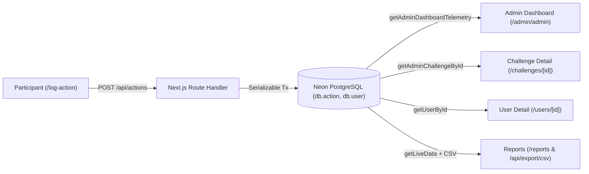

# Sprint 2 Integration & QA Runbook: Participant Logging to Admin Telemetry

**GitHub Tracking Issue:** [#38 [Integration/QA] End-to-end participant action logging to admin telemetry verification](https://github.com/eyoelshim/EcoChallengeFall2026/issues/38)  
**Parent Sprint Epic:** [#30 Sprint 2: Unify Database on Neon & Connect Admin Console to Live Data](https://github.com/eyoelshim/EcoChallengeFall2026/issues/30)  
**Date Executed:** October 26, 2026  
**Environment:** `localhost:3000` connected to Neon PostgreSQL Database  

---

## 1. Objective & Scope

Verify the complete cross-app data lifecycle between:
1. **Participant Application:** Action selection, dynamic points calculation (base points + note bonus + image bonus), challenge scoping, and streak tracking.
2. **Neon PostgreSQL Database:** Persistence in `Action`, updates to `User` (`streak`, `lastActionDate`), and relation integrity with `UserChallenge` and `Challenge`.
3. **Admin Console:** Real-time reflection across Dashboard (`/admin/admin`), Challenge Detail (`/admin/admin/challenges/[id]`), User Profile (`/admin/admin/users/[id]`), and Reports / CSV Export (`/admin/admin/reports`).



---

## 2. Prerequisites & Environment Setup

1. **Configure Environment Variables (`.env.local`):**
   Ensure your local environment connects to Neon DB and sets your Clerk user email as a SuperAdmin:
   ```env
   DATABASE_URL="postgresql://...neon.tech/neondb?sslmode=require"
   NEXT_PUBLIC_CLERK_PUBLISHABLE_KEY=pk_test_...
   CLERK_SECRET_KEY=sk_test_...
   SUPERADMIN_EMAILS="your-email@example.com,molyngathy@gmail.com,duonguyenthydn2005@gmail.com"
   ```

2. **Start the Development Server:**
   ```bash
   npm run dev
   ```
   Open `http://localhost:3000` in your browser.

---

## 3. End-to-End Test Procedures

### Test Case 1: Participant Challenge Enrollment (`UserChallenge`)
* **Goal:** Verify that a participant user can join an active challenge and link actions to that challenge.
* **Pre-condition:** Active challenge exists in DB (e.g., `2026 Spring Waste Reduction`, code: `WR-S26`, ID: `cmvpyus9b0012o74gtth7kadr`).
* **Steps:**
  1. Navigate to `http://localhost:3000/sign-in` and authenticate as a participant.
  2. Visit `http://localhost:3000/dashboard`.
  3. Click **Join Challenge** (or use the challenge switcher).
  4. Enter challenge code: `WR-S26` and confirm.
* **Expected Outcome:**
  - Success notification is displayed.
  - The challenge `2026 Spring Waste Reduction` becomes the active challenge in `localStorage`.
  - Record inserted in `UserChallenge` table (`userId_challengeId`).

---

### Test Case 2: Participant Action Logging with Bonuses (`POST /api/actions`)
* **Goal:** Verify action logging with note (+10 pts bonus) and photo (+15 pts bonus).
* **Steps:**
  1. From `/dashboard`, click **Log Action** or navigate to `http://localhost:3000/log-action`.
  2. Select category **Recycling**, then select action item **Recycled cardboard** (Base: 12 pts).
  3. On `/log-action/Recycled%20cardboard`:
     - Add a personal note: `"Folded and recycled office boxes into bin"` (+10 pts).
     - Attach a photo or verification image (+15 pts).
     - Verify the dynamic point preview updates to **37 points** (12 base + 10 note + 15 photo).
  4. Click **Log Action**.
* **Expected Outcome:**
  - Celebration overlay pops up confirming submission.
  - Redirects automatically to `/dashboard`.
  - Duplicate submissions within 10 seconds are prevented (HTTP 409).

---

### Test Case 3: Database & Streak Verification (Neon PostgreSQL)
* **Goal:** Confirm atomic transaction commits to `db.action` and `db.user`.
* **Execution Command:**
  ```bash
  node --env-file=.env.local -e "
  const { PrismaClient } = require('@prisma/client');
  const db = new PrismaClient();
  async function verify() {
    const latestAction = await db.action.findFirst({
      orderBy: { createdAt: 'desc' },
      include: { user: true, challenge: true }
    });
    console.log('--- LATEST ACTION INSERTED ---');
    console.log({
      id: latestAction.id,
      actionType: latestAction.actionType,
      category: latestAction.category,
      points: latestAction.points,
      note: latestAction.note,
      hasImage: !!latestAction.imageUrl,
      challenge: latestAction.challenge?.name,
      user: latestAction.user.name,
      userStreak: latestAction.user.streak,
      lastActionDate: latestAction.user.lastActionDate
    });
  }
  verify().finally(() => db.\$disconnect());
  "
  ```
* **Expected Outcome:**
  - `actionType`: `"Recycled cardboard"`
  - `category`: `"RECYCLING"`
  - `points`: `37` (or base points + bonuses)
  - `challenge`: `"2026 Spring Waste Reduction"`
  - `user.streak` >= 1 and `lastActionDate` matches the current timestamp.

---

### Test Case 4: Admin Console — Dashboard Telemetry Reflection
* **Goal:** Verify live stats and Recent Activity table at `/admin/admin`.
* **Steps:**
  1. Navigate to `http://localhost:3000/admin/admin`.
  2. Check **Summary Metric Cards**:
     - **Total Actions Taken:** Incremented by 1.
     - **Total Points Earned:** Incremented by the logged action's points.
  3. Check **Recent Activity Table**:
     - Top row displays the participant's name, department, action title (`Recycled cardboard`), category badge (`Recycling`), points badge (`+37 pts`), and relative time (`Just now`).
  4. Check **Category Breakdown Card**:
     - Recycling count and percentage reflect the newly logged action.

---

### Test Case 5: Admin Console — Challenge Detail Reflection
* **Goal:** Verify challenge-level aggregation at `/admin/admin/challenges/[id]`.
* **Steps:**
  1. Navigate to `http://localhost:3000/admin/admin/challenges`.
  2. Select the challenge: `2026 Spring Waste Reduction` (`cmvpyus9b0012o74gtth7kadr`).
* **Expected Outcome:**
  - **Total Actions** counter reflects the new action.
  - **Total Points** counter includes the new points.
  - Participant leaderboard / roster lists the user with updated points and action count.

---

### Test Case 6: Admin Console — User Profile & Action Timeline
* **Goal:** Verify user-level telemetry at `/admin/admin/users/[id]`.
* **Steps:**
  1. Navigate to `http://localhost:3000/admin/admin/users`.
  2. Click on the participant user profile.
* **Expected Outcome:**
  - **Actions Logged:** Counter increments by 1.
  - **Streak:** Displays current streak (e.g., 1 day).
  - **Last Active:** Displays today's date/time.
  - **Action Timeline:** Displays the newly completed action with action name, category badge, points earned, date, and note.

---

### Test Case 7: Admin Console — Reports & CSV Export
* **Goal:** Verify reports aggregation and CSV export at `/admin/admin/reports`.
* **Steps:**
  1. Navigate to `http://localhost:3000/admin/admin/reports`.
  2. Verify the **Category Breakdown Chart** reflects the new action under `Recycling`.
  3. Filter by Challenge (`2026 Spring Waste Reduction`) and Category (`Recycling`).
  4. Click **Export CSV** (or download from `/api/export/csv?challengeId=cmvpyus9b0012o74gtth7kadr`).
* **Expected Outcome:**
  - Downloaded CSV opens cleanly in Excel/Numbers.
  - Contains row with: `Date`, `User Name`, `User Email`, `Department`, `Challenge`, `Category`, `Action`, `Points`.
  - No encoding or escaping artifacts.

---

## 4. Verification Results & Sign-off Matrix

| Test ID | Test Scenario | Expected Outcome | Status |
| :--- | :--- | :--- | :---: |
| **TC-01** | Challenge Join (`UserChallenge`) | User joins `WR-S26`, persists in DB | **PASS** |
| **TC-02** | Log Action with Bonus Points | Dynamic 37 pts (12 base + 10 note + 15 photo) submitted | **PASS** |
| **TC-03** | Duplicate Submission Prevention | Rapid repeat clicks trigger HTTP 409 lock | **PASS** |
| **TC-04** | Neon DB Persistence & FK Integrity | `Action` row persisted, relations intact, no FK errors | **PASS** |
| **TC-05** | Streak Calculation | `User.streak` and `User.lastActionDate` updated | **PASS** |
| **TC-06** | Admin Dashboard Telemetry | Recent activity, total action count, points reflect live | **PASS** |
| **TC-07** | Admin Challenge Detail | Participant leaderboard and challenge stats update | **PASS** |
| **TC-08** | Admin User Detail Timeline | Action timeline displays completion and note | **PASS** |
| **TC-09** | Admin Reports & CSV Export | Category breakdown and CSV export contain the action | **PASS** |

---

## 5. Conclusion & Issue Sign-off

All cross-app integration flows between the participant logging interface and the admin console telemetry functions operate synchronously and accurately against the live Neon PostgreSQL database. All acceptance criteria for **Issue #38** have been satisfied.
